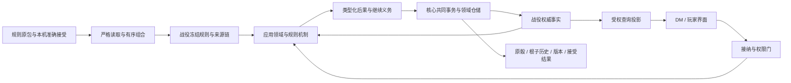

# 模组分层与应用执行架构

本文规定模组与运行架构的职责、接口、事实归属和可独立采用的闭环。当前 SQLite 接合本机
准确接受、有限外部组合及战役冻结规则。各领域实际范围和后续资格分别见
[领域接合表](domain-integration.md)与[采用边界](adoption-boundaries.md)。
不保留旧设计、旧文件或旧来源库的兼容层；同一受支持应用内仍保证准确规则、状态、历史、
事务和直接恢复一致。真实资料保管与处置授权不因设计替换改变。

## 已选范围

- 一个本机 DM，同一时刻一个活动战役；可保管多个完整战役文件，封闭原运行后切换。
- 每次新建或文件打开建立私有 SQLite。原包和准确接受事实由[本机规则库](local-rule-library.md)
  保管。新建和文件打开须具备本机准确原包及接受，活动和同版残留恢复直接读取冻结材料。
- 一个战役可有多个场景，只有一个权威焦点；后台时钟、个人经历与普通行动暂停，切回不补算。
  目标仅允许[登记的跨空间因果链](world-and-scene-spaces.md#causal-scope)结算必要被动后果，
  前后台同阶段共同提交，所需选择沿原链受限继续。世界节点、局部空间和焦点由空间合同规定；
  距离与体积证明、独立日界/黎明分别归[空间几何](spatial-and-area-contract.md)与
  [时间日历](time-and-calendar.md)。
- `base`、`extension`、`compatibility` 使用同一作者和应用接口；组合恰有一个规则根。
  应用支持有限类型化机制，模组只声明内容，不交付行为代码、脚本或任意表达式。
- 本文不另选 Web 框架、进程拓扑或数据库抽象框架。Java/Tomcat、`com.dndtool`、Maven 坐标、
  JNDI 与环境变量合同保持；未来默认切换及旧路由退役作为实施检查点。

## 四层职责与依赖

四层是责任边界，不是四个必须独立部署的服务，也不是规则模组调用数据库的纵向堆栈。

| 层 | 拥有的责任 | 输入与输出 | 不承担的责任 |
|---|---|---|---|
| 运行核心 | 战役/运行身份、归属校验、命令接纳、权限门、事务、幂等、版本推进、随机服务、完整保存与恢复协调 | 有限意图和领域校验结果；提交后的结果、收据和受权投影 | 不解释优势、伤害、回合、施法、移动或状态效果，不自行改角色 HP |
| 应用规则机制与领域 | 游戏语义、规则条件、候选、成本与时机、类型化事实、跨领域协调和历史验算 | 本战役冻结规则、权威状态、有限选择和原骰；类型化结果、状态变化及继续义务 | 不自行提交事务、借新连接写库、加载外部最新规则或等待浏览器 |
| 规则模组 | 完整稳定身份、准确依赖、声明、允许的字段覆盖与来源 | 严格作者包；经组合的不可变定义、参数、引用与覆盖链 | 不决定执行权限、物理表、类名、事件订阅或任意回调，不持有角色实例 |
| 界面 | 呈现受权状态、候选、来源和结果；绘制、缩放、筛选、布局 | 服务端投影；有限业务意图和待校验的预期版本 | 不持有权威骰点、最终修正、规则切换、位置或焦点状态 |

应用装配根选择本版本实际存在的消费者、领域仓储、codec 和支持合同。机制读取领域模型
而非 JDBC record；仓储适配领域类型，不能反过来让 SQL 仓储决定游戏对象形状。
核心通过应用提供的有限领域入口协调完整闭包，不加入按规则键分支的 D&D 算法。
公共事务和安全能力可以被领域调用，领域不得反向调用 Servlet 或解析原始作者包。
不为概念分层预建空类、通用 handler 注册平台或新 Maven 子模块。

## 模组到机制的接口

[模组接口合同](module-interface-baseline.md)负责作者 schema、稳定身份、准确版本、依赖、
顺序、覆盖与五类摘要。本设计补充这些材料如何取得实际执行资格。

每一种可执行规则类型由应用维护一份有限支持合同，至少明确：

| 合同部分 | 必须固定的内容 |
|---|---|
| 声明 | 规则类型与支持的机制/mode、全部字段及值域、复合原子边界、允许覆盖/清空、引用种类 |
| 完整性 | 规则根必需定义、跨类型约束、候选不足和禁用项的处理、准确直接依赖 |
| 执行 | 真实消费者、允许的命令与有限选择、执行时机、资源/随机预算、跨领域 owner |
| 状态 | 唯一事实 owner、前后状态、原骰及来源、版本和根子历史、未决阶段及结束条件 |
| 生命周期 | 全部未来写入足迹、完整文件字段、直接恢复校验、容量与清理依赖 |
| 证据 | 正负作者材料、组合结果独立期望、真实命令/事务/文件/恢复的验收路径 |

这些合同随应用代码维护；不能由模组自报 `supported=true`、接受记录或一个字符串 handler
名称取得支持。未知类型/mode、额外参数、未实现执行分支及缺少必需恢复组件均拒绝。
支持范围可以是一个完整的小机制，不以完整 SRD 发布作为每次扩展的先决条件。
一个可运行组合必须闭合自己声明的全部能力；不能把 `METADATA`、`BLOCKED` 或被禁用内容
伪装成自动执行。只读目录内容仍需结构、引用和来源完整。

`base` 是规则根，不是绕过接口的应用特权包。它选择并完整声明其 profile 所需的机制和
数据；扩展增加内容或修改被允许字段，兼容模组显式协调依赖组合。基础包独立支持的范围
由其声明与真实消费者证明，不要求每个基础包包含全部 SRD，也不允许用缺失依赖冒充完整。
加载顺序只影响声明覆盖，不自动成为运行时效果的执行顺序；效果顺序、叠加和冲突由机制
合同决定。模组启用也不直接授予战役中的任何主体资源或行动权限。

### 数据扩展与行为扩展

改变已支持字段的合法值、增加同类规则条目或引用已有机制，属于内容扩展。应用必须验证
实际消费者使用了新值，不能以目录展示成功代替结算差异。规则说明文字不产生行为。

新增触发时机、选骰方式、目标关系、资源消费、效果种类或允许参数之外的表达式，属于
行为扩展：先补领域合同与应用实现，再开放声明。沿[机制接入清单](mechanism-integration-checklist.md)
补齐真实消费者、状态、历史、继续、文件和故障闭环。纯修正可使用父命令的根与事务，
无须给每个被动特性造独立入口或表。

## 应用内契约

下表为逻辑接口，不是已存在的 Java 类型、HTTP 路由或定稿序列化字段；实施时在当前
代码中整体替换对应调用方，不靠旧模型适配器维持两套语义。

| 边界 | 传入 | 返回及约束 |
|---|---|---|
| 准确组合准备 | 有序准确包、原包/接受证明、应用支持合同 | 完整冻结材料、来源链、机制闭包及诊断；无业务状态写入/RNG |
| 战役初始化 | 准确组合、合法新建输入或完整文件事实 | 规则绑定、全部领域事实及控制；INITIAL 接受前不得执行 |
| 只读候选 | 本战役绑定、已提交状态、真实操作者权限和焦点 | 有界候选与依据、预期版本；只是提案，不预扣成本或锁定结果 |
| 命令预检 | 有限意图、全部目标、冻结规则、当前状态及版本 | 有界执行计划或稳定业务拒绝；含所有可预判分支、写入与继续预算 |
| 随机与求解 | 已通过预检的阶段、服务器提供的原骰、规则与状态 | 确定性类型化结果；应用机制解释骰子，核心不选优势骰或判成功 |
| 领域应用 | 经校验的结果、原状态与唯一根身份 | 新状态、子历史和未决义务；同一字段只有一个 owner 应用一次 |
| 共同持久化 | 全部领域变化、根/子历史、版本和接受结果 | 同一个调用方事务提交；失败整体回滚，未知阻断并查证 |
| 完整恢复 | 保存的准确规则、初始/当前事实、所有历史/时钟/pending | 验证后直接装载；不执行原命令，不补骰、扣费、推进时间或补默认值 |

执行计划是应用内部的有界数据，不向作者开放通用操作列表，也不成为任意字段写入器。
机制之间通过明确领域操作和类型化后果连接。例如伤害交给健康 owner，专注判定交给
对应机制，动作阶段交给动作流 owner；协调者收集为一个原子后果，禁止多个 owner
各自独立修改 HP、资源或效果状态。

## 命令与随机性的共同顺序

1. 取得唯一活动运行的接纳门和调用方事务，核本机执行代次、战役绑定与操作者当前权限。
2. 核幂等键及准确意图。相同键同意图只读原已接受结果；异意图冲突，过时代次不恢复权限。
3. 核完整规则/事实、焦点、目标/候选、预期版本、容量，以及所有掷骰前可判定的条件。
   成功/失败分支都须合法；预留所有可能结果与必需继续后缀，不边骰边发现坏目标。
4. 由应用机制请求有界随机样本。骰数、骰面和采样时机来自已验证计划；原骰由服务器提供。
   机制用固定规则确定选骰、修正和结果，把实际使用的来源写入历史。
5. 需要未来用户选择或反应时，保存已完成前缀、已付成本与唯一待继续叶子，结束本次事务。
   后续以新命令重新预检。未来才出现的触发条件不伪装成已校验，也不持锁等待人类选择。
6. 验证完整候选状态、历史、引用及文件容量后，共同写入全部事实、根/子历史、版本和结果，
   读回核对并提交。成功后才向界面发布可执行状态和结果。

前置拒绝为零 RNG、零业务写入。合法请求采样后发生故障，不要求随机源倒退；已提交
事实、全部回滚和提交未知按真实事务证据区别处理。UNKNOWN 不重新采样或换请求绕过。
继续沿[运行与事务](runtime-and-transactions.md)的一次业务提交及 P0—P3 文件协议，
不引入独立 C0、后台命令重放队列或跨库事务。

## 权威事实与身份

核心管理身份分配、战役归属、引用一致性和共同版本规则；具体事实由应用领域维护。
保存副本、历史前后值和查询投影都不构成第二份可独立修改的 current。

| 事实 | 唯一职责 owner | 与其他事实的关系 |
|---|---|---|
| 战役与规则绑定 | 战役领域 + 核心绑定服务 | 准确组合固定；任何状态/规则引用均属该战役 |
| PC/NPC、记录活动状态 | 主体领域 | 游戏分类、记录状态分别存储，不推导控制权、存活或行动资格 |
| 玩家成员/控制/共享 | 参与领域；核心执行权限守卫 | 设备审批绑定、凭据及会话归本地执行安全，不随业务文件转移；阵营不是权限；DM 代操作记录真实操作者 |
| HP、死亡、职业、资源、装备 | 相应角色/健康/资源/装备领域 | 规则是模板，战役实例有稳定身份与实际消耗；不从模板补当前余额 |
| 怪物及 NPC 实例 | 相应主体领域 | 模板身份与实例身份分离；PC/NPC 分类不作为完整状态模型的选择器 |
| 世界/局部位置、场景、焦点 | 空间领域 | 唯一当前位置，网格与节点不可各存一份可漂移位置 |
| 战斗、行动与反应 | 战斗及动作流领域 | 模式/参战/行动资格由机制判断；焦点/地图缩放不自动开始战斗 |
| 效果、持续与压制 | 持续效果领域 | 存续、有效贡献和永久结束分开，关联实际来源与时间域 |
| 游戏时间与日历 | 统一时间服务 | 唯一写入空间秒、日历 occurrence 和个人经历；领域消费自己的资格/活动/恢复事件，后台不推进；墙钟和 UI 计时不驱动规则 |
| 实物、表面、容器及同调 | 物件领域，外部落位归空间 | 真实安置父链与充能/恢复余额唯一；符文、装备、形态及施法共读，不另造库存或位置副本 |
| 根序号、提交结果、完整恢复 | 核心协调各领域 owner | 全战役一个因果根序列，不把不同场景逻辑秒相加当全局游戏时刻 |

目标身份明确区分 `campaignId`、主体/实例身份、准确规则绑定与本地 `runId/epoch`。
已记录业务事件引用稳定业务身份；文件打开新建本地执行身份，不改变已记录业务关系。
当前 prepared `runId/snapshotId` 作为业务引用保留是现有格式事实，不规定新模型必须继续
使用该命名。采用新模型时同步改类型、引用、codec、文件及测试，拒绝旧格式，不保留隐式转换。
同一模板可创建多个实例；显示名允许重复，不用数据库行号或界面列表序号作为业务身份。

## 固定规则、缓存与查询

每个战役绑定有序准确成员及其原包/逻辑摘要、组合算法、组合/最终规则/覆盖链摘要，
同时绑定应用当前支持的解释合同。准确接受只证明本机同意该材料，不能替代机制支持。
完整规则及来源随运行和文件保留，不能只存最终数字、目录名或一个未经验证的摘要。

普通命令、初始化候选、角色计划、规则说明、来源展示和恢复验算均从同一战役上下文读取。
应用内静态常量可表达实现支持范围和算法边界，不得以全局默认包替代当前组合。
可共享已验证不可变材料；缓存键必须包含准确组合及解释合同，不能仅按规则键或最终规则
摘要缓存。缓存丢失可以重读已验证材料，不能回源到“最新版本”或重建缺失业务事实。

界面只读取已提交、按权限裁剪的投影。DM 的焦点切换是业务命令；浏览其他地图、缩放、
筛选和更换布局只是展示操作。影响距离、遮挡、地形、路径、目标或计时的编辑必须有
服务端类型化命令与历史。玩家不能通过完整快照、隐藏候选或规则来源拿到未共享信息。

## 当前采用与后续边界

| 边界 | 当前实现 | 后续采用责任 |
|---|---|---|
| 准确组合 | DM 从本机已接受材料中选择 1–8 个有序准确成员。内置原包可导入，外部包走同一 reader/compose 与应用支持门。现有建卡模板及有限机制的完整性决定可执行范围。[本机规则库](local-rule-library.md)、[CampaignRuleSupport](../../../src/main/java/com/dndtool/service/storage/CampaignRuleSupport.java) | 新机制扩展按消费和恢复闭包验收。存储需求由应用机制映射 |
| 冻结与恢复 | SQLite 和完整文件保存解释合同、准确成员与摘要、全部最终规则、条目和来源链。打开时复核本机接受并重新组合，逐项与文件材料核对。活动与同版残留重建自身投影，最多共享两份以完整不可变材料为键的已核验上下文。[Material](../../../src/main/java/com/dndtool/service/storage/CampaignDomainData.java)、[CampaignDomainValidation](../../../src/main/java/com/dndtool/service/storage/CampaignDomainValidation.java) | 扩展机制须保留同版解释、完整事实与不回源恢复 |
| 规则消费 | 创建、初始计划和选择、候选、目录及来源、执行和历史验算使用同一战役冻结材料。[CampaignRuleContext](../../../src/main/java/com/dndtool/service/storage/CampaignRuleContext.java)、[CampaignDomainCommands](../../../src/main/java/com/dndtool/service/storage/CampaignDomainCommands.java) | 新机制沿相同边界登记自己的消费者、状态和恢复闭包 |
| 领域模型 | 角色事实和历史、战斗历史、准备身份由领域类型拥有。领域验证结构和规则语义，JDBC 与文件负责读写适配，共同事务由调用方协调。[角色事实](../../../src/main/java/com/dndtool/service/Schema2CharacterRuntime.java)、[战斗历史](../../../src/main/java/com/dndtool/service/Schema2CombatHistory.java)、[准备身份](../../../src/main/java/com/dndtool/service/Schema2PreparationIdentity.java)、[领域引擎](../../../src/main/java/com/dndtool/service/CampaignDomainEngine.java) | 按新机制扩展领域与适配边界，维持原子后果和完整恢复 |
| 代表检定 | 家规组合用感知处理 Athletics，工匠授予侏儒语，直接伤害定额为 3。标准组合分别使用力量、矮人语与定额 6。两套共享检定机制和两分支预检，实际分支与根子后果随完整事实保存。[检定规则](../../../src/main/java/com/dndtool/service/Schema2CharacterCheckRules.java)、[两分支后果](../../../src/main/java/com/dndtool/service/storage/CampaignCheckEffects.java) | 其他机制各自依真实入口和机制清单验收 |
| 核心协调 | `CampaignStorageService` 仍集中接纳、随机服务、视图和文件流程。[存储服务](../../../src/main/java/com/dndtool/service/storage/CampaignStorageService.java) | 共同保障继续与具体 D&D 语义分开，保持领域后果、仓储与生命周期闭合 |
| 空间 | 已采用世界节点、局部 5 尺网格、多场景单焦点、后台冻结、源空间旅行与个人经历；format 3 保存全部空间和 pending。[空间合同的当前范围](world-and-scene-spaces.md#当前采用范围) | 接入真实体积、独立日历与受限跨空间被动后果；现有平面格位不证明这些机制已支持 |
| 规则行为接口 | 原有限消费者的范围由[领域接合表](domain-integration.md)列证 | [行为复验](rule-behavior-interface-validation.md)分别记录原设计、修订设计和程序证据；动作/效果/施法/角色、日历/几何/物件各自拥有正式合同 |

## 可独立采用的顺序

以下是依赖顺序，不把设计提交称作运行支持；每步都包括代码、受影响合同与验证。

1. **规则绑定与检定闭环。** 当前创建、候选、展示、检定及两分支后果共享战役上下文和领域类型。
   原骰、来源、完整文件和直接恢复沿共同事务合同。
2. **本机规则库与外部内容。** 当前采用原包保管、独立准确接受、有序选择及新建和文件打开复核。
   外部内容限现有建卡模板与应用已实现机制。原 MySQL 来源独立管理。
3. **空间与焦点时间。** 当前已接合世界节点、局部网格、多场景单焦点、暂停时间、入退/
   转移及全部冻结 pending 的保存恢复；实际有限边界见空间合同，不能由此推导体积或跨空间效果。
4. **逐机制扩展。** 按时间/跨空间政策 → 检定、替代攻击、联动移动、真实区域与物件 →
   形态、召唤、充能和储存施法的依赖顺序采用正式合同。每个切片闭合消费者、历史和恢复，
   逐项通过机制清单。设计复验不是运行验收；完整 SRD 发布与真实资料处置分别验收和授权。

施法与其他机制按各自实际范围验收。
旧消费者如已无目标责任，可以连同旧调用方和只固定旧模型的测试删除；公共不变量及
仍在当前运行使用的行为必须由新链路覆盖。禁止双写、失败回退或静默转换旧保存材料。

## 端到端验收矩阵

| 例证 | 独立核对内容 | 拒绝/故障闭包 |
|---|---|---|
| 应用交付的标准与家规组合 | 两组有序身份、允许的字段覆盖、完整来源链、真实结算与初始事实差异 | 错绑接受、完整材料或链篡改拒绝 |
| 外部 base、声明扩展与准确兼容组合 | 有序身份、允许的字段修改、来源链和结算差异。各包角色走同一接口 | 两个 base、错版本/顺序、缺直接依赖、重复/未知字段、未知机制均在运行前拒绝 |
| 普通检定及两分支后果 | 手工给定原骰与期望结果、全部受影响对象、实际分支和唯一根 | 未选分支非法也零骰；stale/越权/非焦点命令零写；晚写失败整根回滚 |
| 相同请求重放与提交未知 | 原骰、成本、版本、根/子历史及原接受结果一致 | 重放不执行；未知先阻断，查证后恢复，不凭超时补做 |
| 多战役先后运行 | 每个战役自己的完整组合、实例与来源；切换后无缓存/会话泄漏 | 外战役目标、旧 epoch/候选以及不同组合错误引用拒绝 |
| 多场景单焦点 | 背景状态/时钟/效果剩余时间不变，切回不追赶，切换事实入根历史 | 跨场景未支持的影响和转移依赖拒绝；失败不半切换 |
| 保存任意已提交中途状态 | 所有场景、角色、原骰、资源、根子历史、时钟、焦点和待继续叶子 | 篡改材料/链/状态/历史拒绝；恢复不调用游戏执行或 RNG、不补字段 |
| 文件移机与本机残留 | 新打开具备准确原包/本机接受；残留直接核本库完整冻结事实 | 文件不能自报接受；缺包阻断新打开，来源离线不阻断活动/残留 |

规则绑定的定向入口包括 `BundledCampaignRulesTest`、`LocalRuleLibraryTest`、`CampaignRuleSupportTest`、
`CampaignRuleContextTest` 与 `CampaignRuleBindingIntegrationTest`。规则、领域后果和恢复由 `Schema2CheckCompositionTest`、
`CampaignDomainEngineTest`、`CampaignCheckEffectsTest`、`CampaignDomainsCombatIntegrationTest`
与 `CampaignDomainRecoveryTest` 覆盖相关路径。按测试指南运行有关定向测试，生产代码或资源
变更后执行 WAR 审计。真实数据库操作、部署与发布各守独立检查点。[测试指南](../../testing.md)
