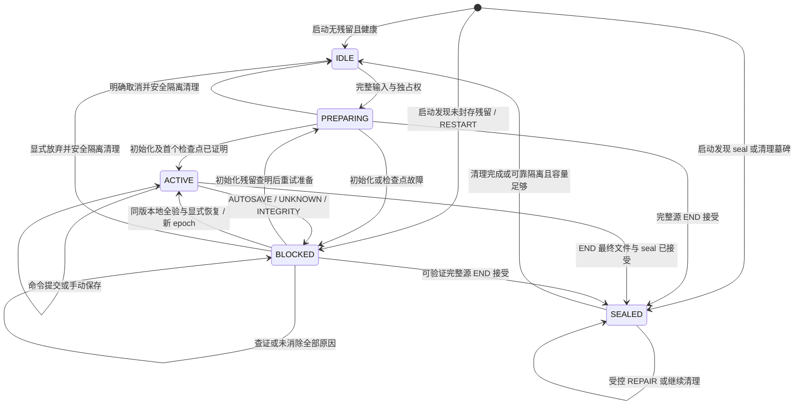

# v2 运行、事务与执行资格

状态：选择每次打开独立私有 SQLite 运行库的目标模型；完整业务装配、SQLite 存储、完整
文件及本页生命周期均未实现。当前生产仍使用 MySQL；
[共同业务事务](../../rules/business-write-transactions.md)、
[内部快照链路](../../rules/schema-2-runtime-snapshot.md)和各领域 INTERNAL 消费者是现有
实现证据，不能作为 SQLite 已采用或完整战役可执行的证据。本页替换目标设计，不要求
迁移旧运行数据；实际数据库重建、部署及真实数据删除仍需独立授权。

## 单一运行权威与组件责任

一次打开建立一个应用控制的私有运行目录及 SQLite 库。准确规则快照和覆盖链、战役与
角色当前状态、全部业务历史、动作继续、持续效果、幂等结果及运行控制都归同一个运行库。
同一战役内所有角色和领域共用本次 `run_id` / `snapshot_id` 及公共事件尾；不能沿用现有
INTERNAL 单角色各自绑定 run 的物理形状来拼装完整战役。

来源 MySQL 保留独立的来源、安装和接受账本责任，初始化时只读准备，不参加运行提交。
运行开始后从本地规则快照读取，来源连接或启动目录不成为第二份运行权威。可移植文件
是一个已验证 revision 的不可变检查点；活动状态以运行库为准，不同步修改文件来推进
游戏。运行库不保存另一份可独立恢复的档案字节。边界按
[规则存储](rule-storage-and-versioning.md)及[保存与恢复](save-and-recovery.md)。

保持单 Maven WAR 和现有职责根包。规则纯模型、验证及 canonical 属于 `module`；Service
拥有命令协调及事务，Repository 接受调用方连接，不自行提交、回滚、关闭或另开写连接。
文件 codec 只解析、编码及产生无副作用恢复计划；文件发布、运行目录管理和业务规则读取
由各自责任方协调。Servlet 不构造来源仓储，普通消费者不能发布执行资格。

应用提供固定 SQL 模块及有限依赖描述，按实际引用图装配所需结构；不接受模组自带 DDL、
脚本或任意 JSON 列充当未实现领域。缺少领域 schema、验证、保存投影或恢复消费者时
拒绝初始化，不能建空表、空历史或空角色掩盖缺口。

## 准备、初始化与执行

1. **输入与来源准备**：仅在健康空闲时选择准确有序规则组合。新建输入先满足完整战役
   公共合同：稳定战役/角色/玩家键与名单映射、每个角色真实初始卡和当前状态、完整规则
   引用、空间/场景和时钟、模式/步骤及一致事件尾。任意加入等级须由对应消费者验证，
   不能把初始授予计划、一级模板或空角色视为完整输入；新建编辑器仍未实现。文件恢复
   经严格 reader 验证完整业务图与历史。两种输入均重新核验所选来源和准确组合。
2. **固定来源材料**：在来源同连接只读 `REPEATABLE_READ` 事务中完整读取来源、安装/
   接受事实与所需材料。正常结束事务并关闭连接后，重建并验证最终规则及完整覆盖链，
   形成仅供本次使用的固定材料；不做跨库提交，不复用旧检查报告作为执行资格。
3. **运行原子初始化**：取得目录独占所有权，在新库事务中写入同一 run/snapshot 的
   规则、链、完整业务/历史、初始本地版本、幂等与控制，实际全量读回。文件独立恢复
   保留可移植业务键和事件序号，生成新 run/snapshot/本地行映射，当前 CAS 从新起点
   建立；不恢复旧命令执行权，不重掷、补授予或重演历史。
4. **首个完整检查点**：初始化明确提交后仍为 `PREPARING`，按保存合同完成首个完整
   检查点及运行库收据。该成功点与完整读回均已证明后，才能发布本进程执行视图并开放
   游戏写入。输入文件存在不等于新运行已完成该检查点。

准备视图没有执行资格。执行视图绑定 campaign、run/snapshot、安全代次 `epoch` 和本地
完整性事实；可变状态重新读取运行库。部分目录或已提交但未完成首个检查点的初始化
属于待处理材料，不因刷新页面或重启进入 `ACTIVE`。

## 共同接纳与事务

新模型使用工具级进程接纳门、受控根的操作系统独占实例锁及运行目录所有权，配合
SQLite 单写事务。工具一次只持有一个活动运行；第二进程既不能打开同一目录，也不能
另选目录绕过单运行接纳。先取得进程门并证明实例/目录所有权，再借连接；写事务使用
`BEGIN IMMEDIATE`，不把 MySQL 的
`SELECT ... FOR UPDATE`、行锁层次或 `READ_COMMITTED` 语义搬到 SQLite。

选择 rollback journal `DELETE`、`synchronous=FULL`，每个连接启用并核验
`foreign_keys=ON`，事务借还及读写能力由同一边界控制。忙等待有界；争用拒绝发生在 RNG
与业务写入之前，不持数据库事务等待浏览器或写入文件。平台锁、驱动事务、刷盘及崩溃
语义必须由真实 SQLite 验证，未证明前保持入口关闭。引擎负责热 journal 恢复，应用不能
自行删 journal 来取得锁、掩盖不确定结果或制造空闲。

完整意图、规则、目标、当前版本、epoch、幂等、容量与领域条件在 RNG 和写入前校验。
一个新游戏命令一个短业务事务，状态、公共根事件、类型化正文、受影响聚合版本及唯一
接受结果同时提交或回滚。每次成功新业务提交推进本地 `commitRevision`，它标识完整
可保存业务投影的变化；只读、精确重放和保存控制事务不推进。失败不推进版本或事件尾。

相同请求键、相同规范业务意图只读返回原接受事实；相同键不同业务意图冲突。原接受结果
与当前执行视图分开，旧 pending 结果不授予当前阶段资格。epoch 是本次接纳的安全授权，
不属于可借换键改变的业务意图；新执行须带当前 epoch 和当前依赖版本。禁止用新请求键
掩盖未决命令。幂等事实存于本次运行，不建公共全局永久收据库。

切换时必须同时接合所有生产写入口。旧 MySQL 活动战役、未决写入或隔离不明的清理阻止
新运行，不能让旧写路径和 SQLite 各自宣布空闲或并行写入。本页不授权使用新清理流程
删除旧 v1 数据；旧运行处置与新实现采用是不同检查点。

## 动作暂停与继续

攻击、移动、施法、反应及必需选择共用[动作继续协议](action-continuation-protocol.md)。
动作流保存唯一位置及父子关系，各领域保有资源、位置、原骰和效果事实；暂停是已提交
完整状态。窗口 CLOSED 而父阶段未继续时仍阻断普通写入。继续命令在当前 epoch、叶子
及版本下重新预检，保留已发生消耗、决定与路径前缀。

生命周期门优先于动作流。`BLOCKED` 或重启残留不能凭 pending 继续；保存、查证和技术
END 不隐含 PASS、resolve、停止专注、退出战斗或计步。同版残留经完整查证后可显式恢复
本地运行，再用新受保护命令继续原叶子；不强制先 END 再导入文件。

持续效果遵循[持续效果协议](ongoing-effect-protocol.md)。完整来源、目标、压制原因、
贡献依赖、到期及后继消费者一并验证，变化、历史、版本和待结义务原子提交；需要选择
时接到唯一动作流。稳定效果不长期占用动作流。查询不得顺带到期、解除压制或补回调，
缺消费者不能以“无贡献”通过。保存覆盖活动及历史因果所需的全部已终结事实。

## 提交结果与持久查证

| 证据 | 结果与后续行为 |
|---|---|
| 未调用 commit，完整 rollback 明确成功 | 本次未提交；保留已提交源和原意图，按当前生命周期判断后续接纳。 |
| commit 明确成功，之后连接归还或响应失败 | 保留已提交事实，不改报回滚，不重执行业务。 |
| commit 响应不明，或 rollback 失败 | 原操作未决，进入 `BLOCKED(UNKNOWN)`，立即撤销游戏执行资格。 |

UNKNOWN 归因不能只存在于 Java 的 pending 字段。运行库内须持久保留原接纳意图：准确
operation、规范业务意图/摘要、每次接纳 epoch、预期 revision、提交前完整源指纹、目标
及依赖版本。C0 独立短控制事务明确提交该最小意图后才可能执行业务；C0 自身结果未知
时不启动业务。意图不证明接受，也不存第二份当前状态；业务状态/历史/最终接受结果及
该意图的接受事实仍在唯一业务事务中提交。

业务未执行、拒绝或明确 rollback 成功且没有接受结果时，还需独立短控制事务把原接纳
登记为 `NOT_COMMITTED` 或取消；该控制事务明确提交后，才可接纳下一命令。它不是业务
成功结果，不推进 revision。登记未知则继续阻断并查证，不能让后续 revision 变化抹去
尚未裁定意图的提交前证据。一次只允许一个未决接纳者；意图、准确尝试与已决结果保留
至本次运行结束。C0、业务事务和未提交裁定均可分别查证，不依赖进程内字段。

查证先终止并确认原执行者不再写入，持有目录独占锁，让 SQLite 完成正常引擎恢复，再
以新的健康连接做一致读。不能把 `close()`、超时、普通空查询或事后 rollback 当作未提交
证明，不能把可疑连接放回健康池。核对原意图、接受结果、revision、完整状态/历史和因果
闭包：完整匹配才证明已提交；C0 已持久、原执行者已隔离、恢复完成、无接受结果且完整
状态仍等于该意图的提交前版本/指纹，才能证明业务未提交。

C0 自身的未知须单独判定：能够证明该次尝试仍停留 C0 阶段、原执行者已隔离、引擎恢复
及结构完整、准确 operation 无 C0/无接受结果，且完整前状态与原意图的独立证据一致，
可以判为 `NOT_STARTED`。因为业务必须在 C0 明确持久后才能启动，此时没有可裁定的业务
提交；不能仅因 C0 缺失永久阻断，也不补造接受结果。若可能已进入业务阶段却缺 C0、有
接受结果却无 C0、出现部分领域变化，或无法证明阶段/隔离/前状态，则保持
UNKNOWN/INTEGRITY；普通空查询始终不足以支持上述结论。

查证本身只读，不自动解除阻断。`NOT_STARTED` 经受保护恢复控制处理后可重新登记原 C0；
已证明业务未提交后，由受保护控制事务持久登记该裁定；
显式恢复取得当前 epoch 后，可以重新授权同一 operation 和同一规范业务意图。该次
尝试仍须通过当前版本、规则及领域预检；意图已不合法则拒绝，不改目标或换键来冒充
原重试。旧 epoch 未接受请求不能直接执行。已提交永远只返回原结果，不自动执行父
后继；同版本地恢复保留这些接受事实和尝试记录。

文件发布与收据提交之间的未知按[保存协议](save-and-recovery.md)核验原意图、准确
fileKey/generation、已发布字节及源 revision。文件存在不证明收据成功，收据未知也不能
删除或另发文件。未决时保留阻断和原材料；新执行资格只能由另一个受保护恢复事务发布。

## 生命周期与恢复

目标只区分 `IDLE`、`PREPARING`、`ACTIVE`、`BLOCKED` 和 `SEALED`，由运行事实推导
接纳判定，不再存可矛盾的状态枚举。`BLOCKED` 原因为 `AUTOSAVE`、`UNKNOWN`、
`INTEGRITY` 或 `RESTART`；多个原因必须全部处理，保存成功不能掩盖完整性故障。
启动可显示 `RESIDUAL`，表示尚无本进程资格的残留，不是可直接执行的第六种模式。
已封存、显式放弃或清理墓碑始终优先判为不可激活。

下表 R/W 指运行库控制或业务读写；发布、封存、REPAIR 与清理成功点以
[保存与恢复](save-and-recovery.md)为准。

| 转换/触发 | 前置及 R/W | 事务与成功点 | 可重入及失败去向 |
|---|---|---|---|
| 启动 `→ IDLE / BLOCKED / SEALED` | 持实例锁，R 分配标记、准确目录、引擎恢复后的控制与 seal/tombstone，不做业务 W | 无残留且健康才 IDLE；未封存残留为 BLOCKED(RESTART)，已封存/清理中为 SEALED；不发布执行资格 | 识别可重复；锁、模型或归属不明保留并阻断，不按空库、空查询或缺文件清除材料 |
| `IDLE → PREPARING`：新建/文件恢复 | 无活动或未决执行者，独占准确新目录；只读来源/输入，写完整初始化 | 来源正常关闭后做本地初始化；首个检查点前不开放写 | 原意图查证/重试；坏输入回 IDLE，已有提交保留 PREPARING，未知转 BLOCKED，不删已提交源 |
| `PREPARING → IDLE`：明确取消准备 | 原操作结果已决、无活跃执行者，R 准备/分配归属，W 取消与清理控制 | 未建完整库按分配标记取消；已有初始化须先持久放弃，再安全隔离清理 | 仅继续原取消；未知保留阻断，隔离不明不能空闲，不删输入/规则/别的运行 |
| `BLOCKED → PREPARING`：重试初始化/首个检查点 | R 原意图/完整初始化结果、规则/业务/历史/原保存点，查清未知且修复完整性，W 准备控制 | 控制事务明确接受后继续同一准备；已提交初始化不重复写，未完成首个检查点不发布 ACTIVE | 原意图查证/重试；失败仍保留准备源或 BLOCKED，不跳过首个检查点 |
| `PREPARING → ACTIVE`：首个检查点完成 | 完整规则/业务/历史读回和准确收据，R/W 本地控制 | 控制事务登记本进程 epoch 后发布视图 | 原意图重放不重复初始化；失败保留准备材料，未知转 UNKNOWN |
| `ACTIVE → ACTIVE`：新业务命令 | 当前 epoch、目标/版本及领域预检，R/W 接纳、状态、历史、结果和 revision | C0 已登记后一个业务事务明确接受；明确回滚则另控制事务裁定 NOT_COMMITTED，裁定明确前不接纳下一命令 | 原 operation/业务意图可精确查证或按新 epoch 重新授权；未知转 UNKNOWN，坏持久事实转 INTEGRITY |
| `ACTIVE → BLOCKED(AUTOSAVE)`：达到阈值 | 新业务已提交，R revision/水位，W 精确保存意图 | 接纳门内建立屏障，后续游戏写不能越过；文件 I/O 不持业务事务 | 原业务不重做；保存失败保持屏障，可重试或显式 END |
| `ACTIVE → ACTIVE`：手动保存 | 暂停接纳并排空命令，R 固定源，W 保存控制 | P0—P3 明确接受后释放短写门，保存不推进业务 revision | 已证明未接受的失败可回原运行；未知转 UNKNOWN，不先放开写 |
| `BLOCKED(AUTOSAVE) → ACTIVE`：检查点成功 | 已发布字节/源/收据核验，无其他阻断，R/W 水位 | 保存接受事务明确成功后移除该屏障 | 重放不再保存；失败仍 AUTOSAVE，未知叠加 UNKNOWN |
| 运行/准备 `→ BLOCKED`：故障或启动残留 | R 原目录、引擎恢复结果、控制及原意图；只允许查证/核验和安全救援 | 隔离旧执行者；启动、GET 或诊断不写 epoch、不激活 | 查证可重复；证据不足保留，不以空查询当空闲 |
| `BLOCKED → ACTIVE`：显式恢复同版本地运行 | 独占权、全部未知已决、完整规则/状态/因果历史/pending/水位核验、首个检查点已证明，无 seal/放弃/tombstone，R 全库、W 新 epoch | 控制事务明确提交后发布视图；保留原 run/snapshot、业务版本、幂等与原待继续状态 | 原恢复意图可查证；失败不激活，旧 epoch 未接受命令拒绝 |
| 未封存运行 `→ SEALED`：END | 排空命令冻结准确源，R 完整业务含 pending，W 最终意图/收据/seal | P3 最终收据和 seal 同事务明确成功 | 封存前已决失败可重试或显式取消；未知只查证，封存后不能取消或恢复游戏 |
| `SEALED → SEALED`：受控 REPAIR | 原库完整且仍等于封存指纹，R 原源/损坏证据，W 新 fileKey 及封存引用 | 新保存接受后更新引用，保留旧收据，不解除 seal | 失败保留源和坏证据；未知只查证，不恢复游戏 |
| `SEALED → IDLE`：清理 | 核最终文件/封存，关闭 DB，W 精确受控目录及最小清理标记 | 原子改名 tombstone 后可重入删除；完整隔离且容量允许后可回空闲 | 部分删除非事务回滚；隔离不明或配额不足继续阻断，墓碑永不激活，只重试准确清理 |
| 残留 `→ IDLE`：显式放弃 | 用户确认准确运行与可能丢失内容，无活跃执行者，R/W 放弃与清理事实 | 先持久撤销资格再走受控隔离/清理；不声称成功保存 | 未接受保留源；已接受仅继续清理；坏库需准确识别目录及损失确认，不能伪造收据 |

同版本地恢复保留同一库及业务进度，只更换安全代次；文件独立恢复建立新运行和本地
CAS，两者不能混用。首个检查点未完成的初始化残留只允许核验后继续准备、救援或显式
放弃，不能走 ACTIVE 的恢复捷径。INTEGRITY 须修复并全量验证才能恢复，不能用确认
按钮覆盖。救援导出仅在完整业务投影可证明时发布合格文件，否则保留原材料和诊断。

只有来源库离线时，本地规则、完整状态和控制健康的本进程运行/同版残留可以继续、显式
恢复、保存及结束；新的来源初始化关闭。运行与文件恢复固定原准确组合，不能借重选
更换版本、顺序或原包。未知、完整性故障、保存屏障及封存优先于来源可达性。
GET、下载、停机和健康检查不初始化、保存、结束或继续动作。

故障验收须分别覆盖 C0 未持久与已持久的响应丢失、业务未执行、业务提交未知、明确
rollback 后裁定提交未知及跨重启查证。独立断言 NOT_STARTED 路径从未调用业务/RNG，
缺 C0 却有接受结果或可能已执行业务时拒绝激活，未提交裁定未知时不允许后续 revision
推进；不能把只测“查询不到结果”的用例当作阶段与全域闭包证明。

WebApp 可在没有活动运行时提供打开入口；坏输入只拒绝该输入。基础设施或完整性故障
使 Host 游戏写入口在既有安全边界后稳定拒绝，健康检查不证明规则或执行就绪。SQLite
约束、并发、事务/文件故障、刷盘、重启与清理实证完成前，本页目标保持未采用。
